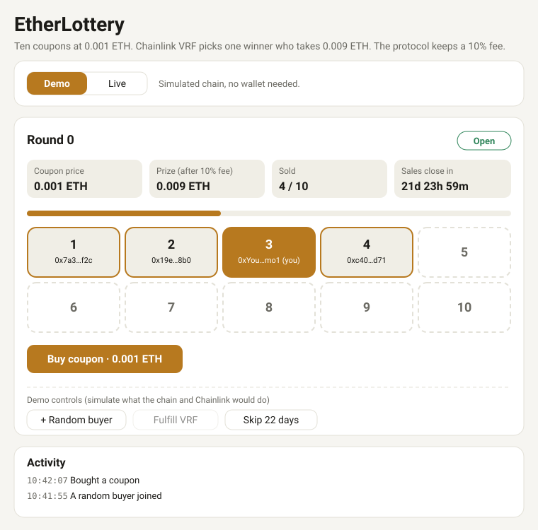

# EtherLottery

A simple EVM lottery contract that uses **Chainlink VRF v2.5** for verifiable randomness, with a single-page frontend.

> ⚠️ **Unaudited.** This is a learning/example project. Have it audited before using it with real funds.

## How it works

| Parameter | Value |
|---|---|
| Coupon price | 0.001 ETH |
| Coupons per round | 10 |
| Pot (10 coupons) | 0.01 ETH |
| Winner prize | 0.009 ETH (90% of the pot) |
| Protocol fee | 0.001 ETH (10% of the pot) |
| Sale window | 2 days from the first purchase of the round |

1. Users buy coupons with `buyTicket()` by sending exactly 0.001 ETH. Each coupon is one entry.
2. Sales close when **10 coupons are sold** or **2 days after the first buyer**, whichever comes first.
3. On the 10th coupon, the contract requests a random number from Chainlink VRF.
4. When VRF responds, a winner is picked (`random % 10`) and credited 0.009 ETH. The remaining 0.001 ETH (10%) is added to `protocolFees`.
5. The winner calls `withdrawPrize()` to collect.
6. The next `buyTicket()` call automatically starts a new round.

If a round expires with fewer than 10 coupons, it becomes **refundable**: anyone can call `closeExpiredRound(roundId)` (or the next `buyTicket()` does it), and each buyer calls `claimRefund(roundId)`.

```
Open ──(10 coupons sold)──► Drawing ──(VRF response)──► Finished
  │
  └──(2 days, < 10 coupons)──► Refundable
```

## Frontend showcase



The frontend is a single file, `frontend/index.html`, with no build step. It follows your system's light or dark theme and works on mobile.

| UI element | What it shows |
|---|---|
| Round header and status pill | Current round number and its state: Open, Drawing, Finished, Refundable or Expired |
| Stats | Coupon price, prize, coupons sold (x / 10) and a countdown to the 2-day sales close |
| Coupon grid | Ten slots filled with buyer addresses as coupons are sold. Your coupons are highlighted, and the winner is outlined |
| Buy coupon | Sends exactly 0.001 ETH. Disabled while a draw is in progress |
| Withdraw / Refund / Close expired round | Appear only when they apply to you |
| Activity | A log of what you did and what happened |

Two modes:

- **Demo:** a simulated chain, with extra controls (**+ Random buyer**, **Fulfill VRF**, **Skip 2 days**) to walk through a full round, a winner, an expiry and a refund without deploying anything.
- **Live:** reads and writes your deployed contract through MetaMask, using the address from `frontend/config.js`.

## Project structure

```
ether-lottery/
├── src/EtherLottery.sol          # the contract
├── test/EtherLottery.t.sol       # Foundry tests (uses the VRF mock)
├── script/EtherLottery.s.sol     # deploy script, also writes frontend/config.js
├── frontend/
│   ├── index.html                # single-page UI (Demo + Live modes)
│   └── config.js                 # generated by the deploy script
├── docs/frontend-preview.svg     # image used in this README
├── foundry.toml
└── .env                          # your secrets/config (never commit)
```

## Quick start

### Just want to see the UI?

No deployment needed. The frontend has a **Demo** mode with a simulated chain:

```bash
python3 -m http.server -d frontend 8000
```

Open <http://localhost:8000>.

### Run the entire project on a testnet

You need [Foundry](https://book.getfoundry.sh/getting-started/installation), Git, Python 3 (or any static file server), a wallet such as MetaMask, and testnet funds (for example Sepolia ETH and LINK from <https://faucets.chain.link>).

#### 1. Get the code and dependencies

```bash
git clone --recurse-submodules <your-repo-url>
cd ether-lottery
```

If you created the project from scratch instead:

```bash
forge install foundry-rs/forge-std
forge install smartcontractkit/chainlink-brownie-contracts
```

#### 2. Configure `foundry.toml`

```toml
[profile.default]
src = "src"
out = "out"
libs = ["lib"]
solc = "0.8.20"
remappings = [
  "@chainlink/contracts/=lib/chainlink-brownie-contracts/contracts/",
  "forge-std/=lib/forge-std/src/"
]
# lets the deploy script write the frontend config
fs_permissions = [{ access = "read-write", path = "./frontend" }]
```

Check it with `forge remappings` and `forge build`.

#### 3. Create and fund a VRF subscription

1. Go to <https://vrf.chain.link> and create a **VRF v2.5** subscription on your network.
2. Fund it with LINK (or native token).
3. Note the **subscription ID**.

#### 4. Create `.env`

```bash
VRF_COORDINATOR=0x...      # VRF v2.5 coordinator for your network
SUBSCRIPTION_ID=1234...    # from step 3
KEY_HASH=0x...             # gas lane key hash for your network
RPC_URL=https://...        # your RPC endpoint
```

Get the coordinator address and key hash from the [Chainlink VRF supported networks docs](https://docs.chain.link/vrf/v2-5/supported-networks). Keep secrets out of Git:

```bash
echo ".env" >> .gitignore
```

#### 5. Deploy (this also sets up the frontend)

Import your deployer key into a keystore once (safer than a raw private key):

```bash
cast wallet import deployer --interactive
```

Then deploy:

```bash
source .env
forge script script/EtherLottery.s.sol:EtherLotteryScript \
  --rpc-url $RPC_URL --account deployer --broadcast
```

The script deploys `EtherLottery`, prints its address, and writes `frontend/config.js` containing the contract address and chain ID. The frontend reads that file, so you don't copy the address anywhere by hand.

> A dry run without `--broadcast` also writes `config.js`, with a simulated address. Deploy with `--broadcast` before using Live mode.

#### 6. Add the contract as a VRF consumer

On <https://vrf.chain.link>, open your subscription and add the deployed address as a **consumer**. This is the one manual step: draws fail until you do it.

#### 7. Start the frontend

```bash
python3 -m http.server -d frontend 8000
```

Open <http://localhost:8000>, click **Live**, then **Connect wallet**. The contract address is pre-filled and your wallet is asked to switch to the deployed chain. Buy coupons and, after the 10th, the VRF draw runs on its own. Winners press **Withdraw** to collect.

Serve the page over HTTP as shown. Wallet extensions often don't inject into pages opened directly from `file://`.

## Tests

```bash
forge test -vv
```

The tests use Chainlink's `VRFCoordinatorV2_5Mock` and cover buying, drawing, prizes, retries, expiry, refunds and a fuzz test. Run one test with `forge test --match-test test_ClaimRefund -vvv`.

## Contract interface

### Write functions

| Function | Description |
|---|---|
| `buyTicket()` payable | Buy one coupon. Must send exactly 0.001 ETH. |
| `withdrawPrize()` | Withdraw prize winnings credited to the caller. |
| `withdrawFees()` | Owner only. Withdraw the accumulated 10% protocol fees to the owner. |
| `claimRefund(uint256 roundId)` | Claim a refund from an expired round. |
| `closeExpiredRound(uint256 roundId)` | Mark an expired round as refundable. Callable by anyone. |
| `retryDraw(uint256 roundId)` | Re-request randomness if VRF hasn't answered after 1 day. |

### Read functions

| Function | Description |
|---|---|
| `currentRound()` | Current round id. |
| `ticketsSold()` | Coupons sold in the current round. |
| `getRound(roundId)` | Players, start time, end time, state, and winner of a round. |
| `ticketsOf(roundId, player)` | Coupons a player holds in a round. |
| `pendingPrize(player)` | Prize amount a player can withdraw. |
| `protocolFees()` | Fees accumulated and not yet withdrawn by the owner. |
| `owner()` | The fee recipient. It is the deployer unless ownership is transferred. |

### Events

`TicketBought`, `DrawRequested`, `WinnerPicked`, `RoundExpired`, `Refunded`, `PrizeWithdrawn`, `FeesWithdrawn`

## Troubleshooting

- **`forge build` can't find `@chainlink/...`:** run `forge remappings` and `ls lib`. If `lib/` is empty, run `git submodule update --init --recursive`.
- **`vm.writeFile` fails:** add the `fs_permissions` line to `foundry.toml`.
- **Buying works but no winner is ever picked:** the contract isn't added as a consumer, or the subscription is out of funds.
- **Frontend Live mode says "No wallet found":** open it through `http://localhost`, not `file://`, in a browser with MetaMask.
- **The VRF doesn't run on a local Anvil node.** The deploy script targets a real VRF coordinator, so use a testnet such as Sepolia for the full flow, or use the frontend's Demo mode.
- **`credential-manager` warning on `git push`:** harmless. Silence it with `git config --global credential.helper osxkeychain` on macOS.

## Protocol fee

When a round finishes (the VRF draw completes), 10% of the pot is set aside as a protocol fee and 90% is credited to the winner:

| | Amount |
|---|---|
| Pot (10 × 0.001 ETH) | 0.01 ETH |
| Winner | 0.009 ETH |
| Protocol fee | 0.001 ETH |

- Fees accumulate in `protocolFees` and the owner collects them with `withdrawFees()`.
- **Refunded rounds pay no fee.** If a round expires with fewer than 10 coupons, buyers get their full 0.001 ETH back.
- The contract balance always equals open-round coupons + refundable coupons + pending prizes + `protocolFees`.

## Design notes

- **Pull payments.** Prizes and refunds are withdrawn by the user, so the VRF callback can never fail because of a winner.
- **Multiple coupons per address** are allowed, one per transaction.
- **VRF costs** are paid from your subscription, not by buyers. The 0.01 ETH pot is split 90% to the winner and 10% to the protocol.
- **Callback gas** is 200,000. Check it against your network.
- **Late VRF responses** after a retry are ignored; only the first counts.

## Known limitations

- The fee is fixed at 10% in the contract (`FEE_BPS`). Changing it requires a redeploy.
- Fees go to `owner()`, the deployer address. Use a multisig or transfer ownership if this is a real protocol.
- No protection against one person buying coupons from many addresses.
- Randomness depends on the VRF subscription staying funded and the contract staying registered as a consumer.

## License

MIT
